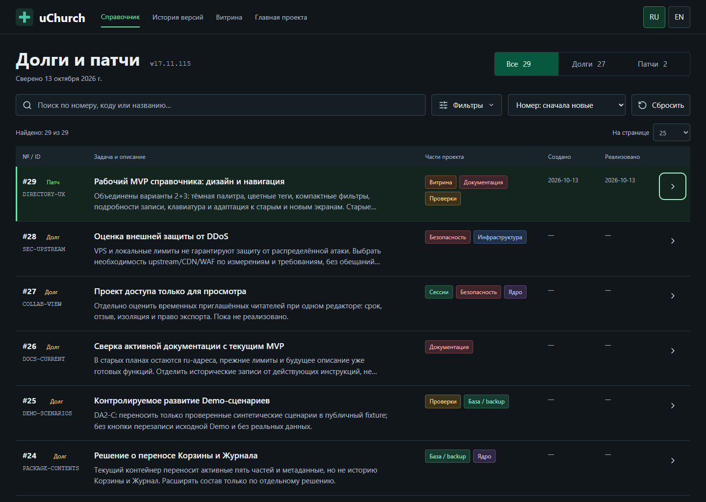

# 2026-10-13 — DIRECTORY-UX v17.11.115

Настоящий снимок локальной проверки1440x1024, не генерированный макет.
Каталог содержит27 открытых долгов и2 патча: №7 и новый UI-патч№29.
Все28 прежних записей сохранены. Пользователь выбрал объединение вариантов2+3
с цветными тегами. CRM и реальные базы на снимке отсутствуют.

Проверены фильтры, подробности, клавиатура/touch, возврат фокуса и13 размеров.
Сначала были обнаружены проблемы640x480 и циклического фокуса; они исправлены
и повторно проверены. [Подробный QA](directory-ux-qa.md),
[фактическое состояние выпуска](release-v17.11.115-receipt.md).
