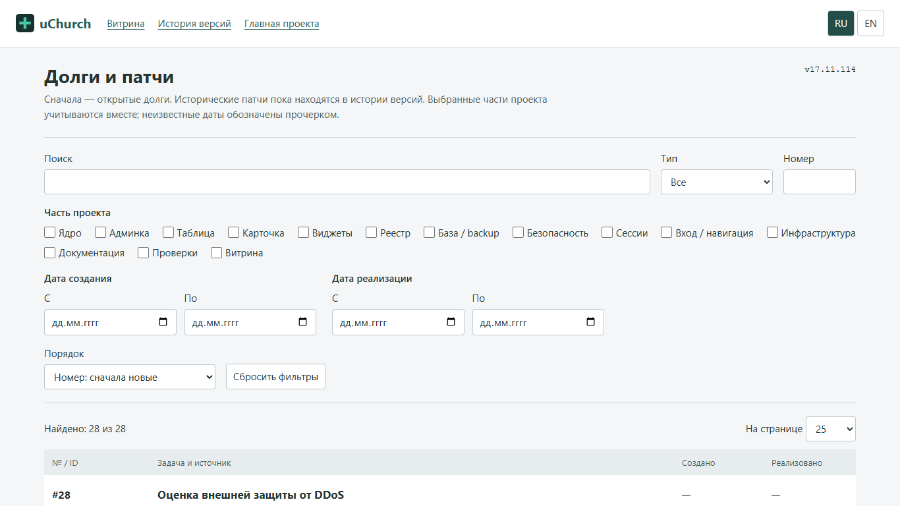

# 2026-10-13 — справочник v17.11.114

Настоящий снимок браузерной проверки, viewport 1366x768. Это публичный список
инженерных задач, не CRM и не база людей. Первично внесены 27 открытых долгов
и запись №7 о реализованном справочнике. Старые патчи остаются в истории версий.
Список не объявляется полным аудитом всех внешних архивов и чатов.

Модель: schema, постоянные ID, два типа, даты, совместные AND-фильтры,
inclusive границы, шесть сортировок, URL, безопасные ссылки: PASS.
Браузер: фильтры вместе, язык, reload URL, ошибочный диапазон, сброс,
пагинация на искусственно расширенном публичном списке, безопасный текст и
заблокированное localStorage: PASS. Восемь viewport: 1024x680, 1280x720,
1366x768, 1920x1080, 2560x1440, 3840x2160, 412x915, 321x568 — без overflow
и обрезанных полей. Это CSS viewports, не физические проверки восьми устройств.

Прежняя витрина: 112 записей версий, RU/EN, все локальные ссылки, прежние два
снимка хроники и четыре viewport — PASS. Исторические записи не удалены.
Отдельные SEC1/SR1/DR1, проверка настоящего оператора и стресс VPS не выполнены
этим узким патчем. [Фактический выпуск](release-v17.11.114-receipt.md).
