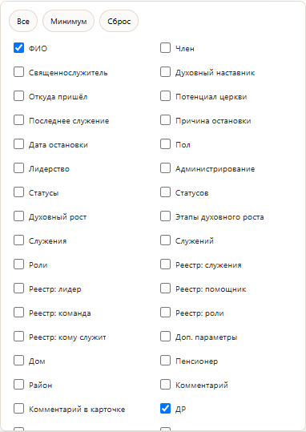

# 13 октября 2026: настройки столбцов

Версия v17.11.113, TABLE-PROFILE. Настоящий снимок видимой части меню столбцов
из изолированного Chrome, синтетическая база, desktop 1366x768. Данных людей,
паролей и recovery на изображении нет. Это иллюстрация интерфейса, а не
самостоятельное доказательство сохранения ширины или порядка.

Исправление сохраняет ширину и сортировку скрытого столбца в браузере.
Порядок из Админки остаётся приоритетным и переносится в защищённом файле базы.
[Отчёт о выпуске и фактических проверках](release-v17.11.113-receipt.md).
